<h1 align="center">Hi, I'm zhmyh 👋</h1>

  <b>Product developer</b> · iOS (React Native) · Web (React + TypeScript) · Python · Unity + Blender

  
  

---

### About

I build products end-to-end and ship them: an iPhone app, web apps with real 3D, a mobile game, payment back-ends, and the tooling that keeps all of it moving. I do the art too: scenes are assembled, lit and rendered in Blender. Every screenshot below is a real capture of a running build.

### Tech Stack

---

## Featured Work

### ♟️ ChessFactory: an iPhone chess app where every move is explained

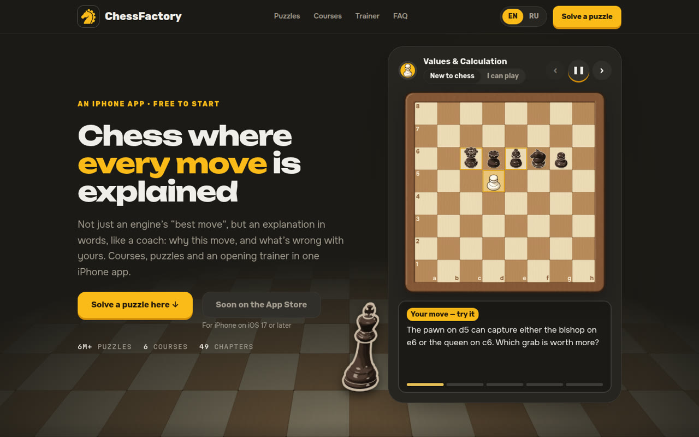

  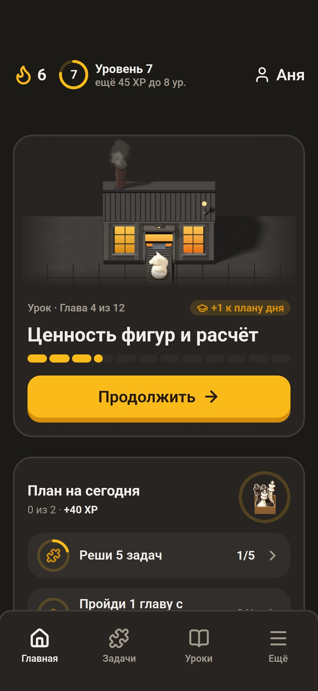
  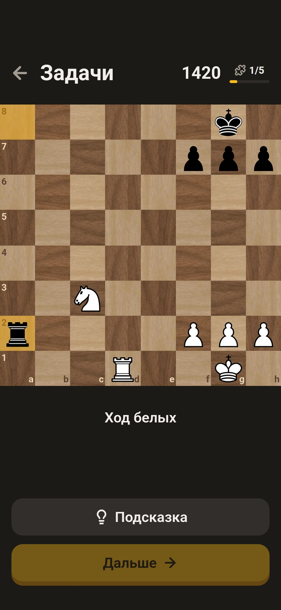
  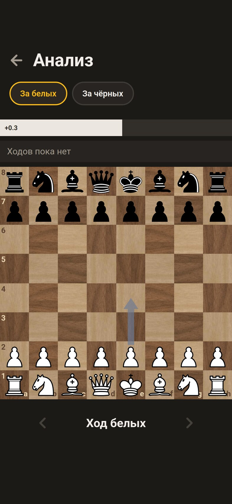

The landing page and the app itself (its web build, running on demo data). Team product, Aug – Nov 2026. My part:

- **iOS app:** about 50 commits on main. I turned the lesson path into an animated chess factory, built the pawn-to-king rank ladder and the home screen, polished the puzzle and analysis boards, and did the performance and Dynamic Type passes.
- **Art:** the pieces, the factory scene and the app icon, built, lit and rendered in Blender from CC0 models (Poly Haven, Kenney).
- **Landing:** [chessfactory.app](https://chessfactory.app), prerendered for search, EN/RU, with a live lesson board in the hero.
- **Palette stand:** the real app running in a browser, where a designer clicks any element and recolours it.

`React Native` · `Expo` · `Skia` · `Reanimated` · `React Router` · `Tailwind` · `Blender`

---

### 🎫 PassTiket: flight and hotel confirmations in PDF

<table>
<tr>
<td width="50%">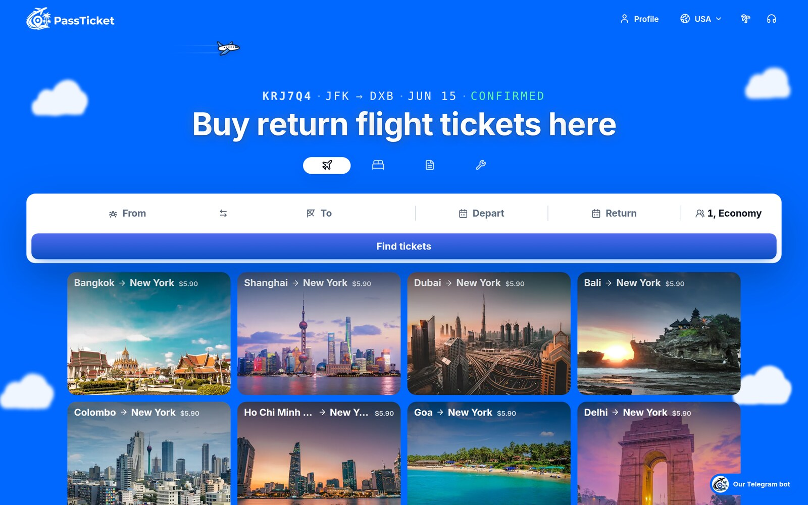</td>
<td width="50%">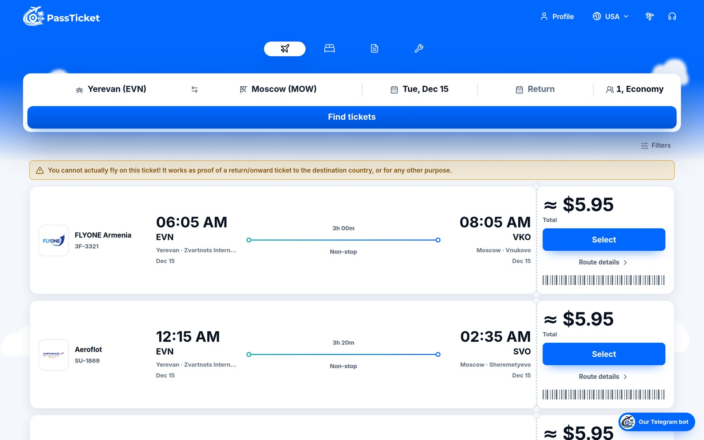</td>
</tr>
</table>

A fixed-price service that issues onward-flight and hotel confirmation PDFs, the kind travellers show as proof of a return ticket. One codebase serves the website, a Telegram bot and a Telegram Mini App from the same server. Flight search fans out to several providers (Aviation Edge schedules, Ignav fares, Travelpayouts price hints) and merges the normalized results. An order is built only from the server-side search cache, so the server ignores any price the client sends. The site is translated into 15 languages.

`React` · `Vite` · `Hono` · `Node.js` · `SQLite` · `Playwright (PDF)` · `grammY`

---

### 🏚 ZALAZ: an invite-only map of abandoned places

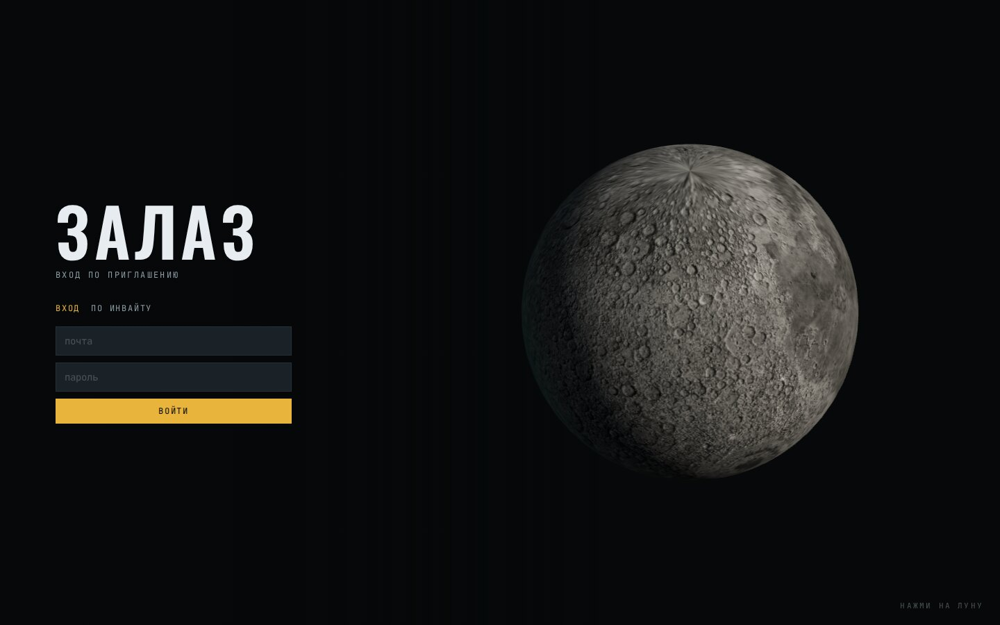

A closed catalogue of abandoned sites in Krasnodar Krai, Crimea and Abkhazia. It has a satellite map with 3D terrain, clustered markers and filters kept in the URL. Each site gets a card with a photo gallery and trip reports. There's also a forum with a rich-text editor, a video section, a chat and an admin panel. You get in with an invite code: codes come from a crypto-strong source, expire and have quotas, registration is closed and logins are rate-limited.

`React 19` · `TypeScript` · `MapLibre GL` · `three.js` · `PocketBase` · `TipTap` · `Tailwind 4`

---

### 🧽 Rug Rush: a mobile idle arcade about a carpet-wash yard

  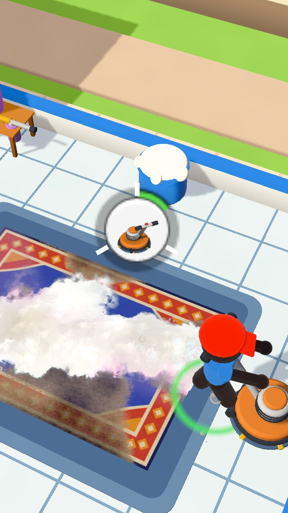
  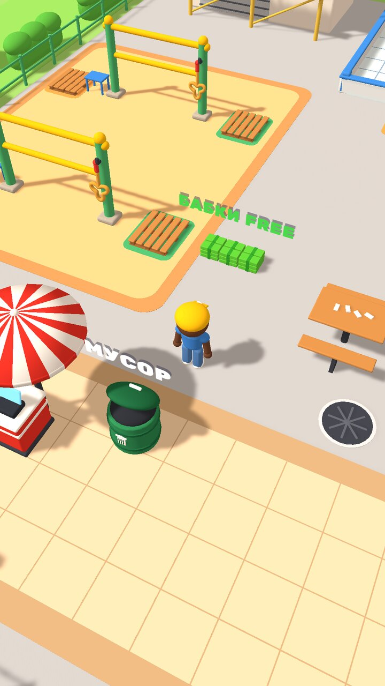
  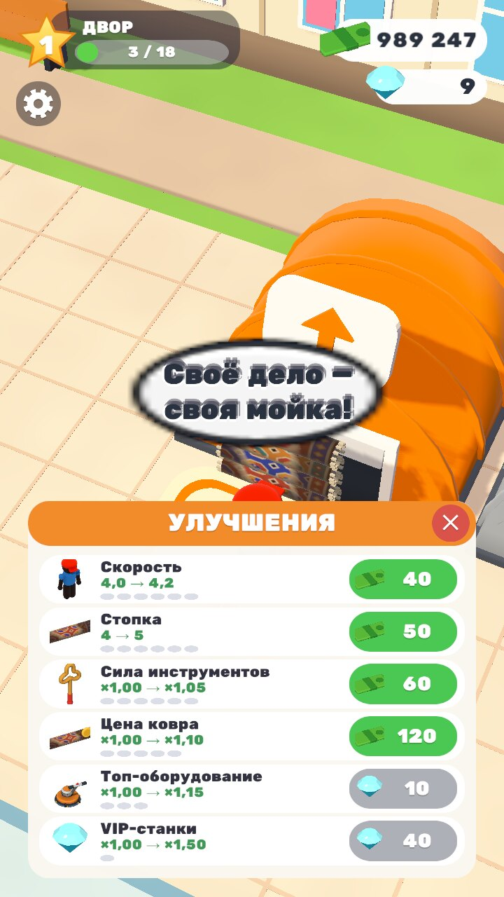

You take rugs in, beat them, foam and rinse them, dry them on racks, hand them back and spend the money on upgrades. The yard grows from one tarp to a whole workshop. It's built in Unity 6.3, and the models, characters and props were put together in Blender.

`Unity 6` · `C#` · `Blender`

---

### 🎸 Pistoletov.fm: a fan site with a procedural 3D dungeon

<table>
<tr>
<td width="50%">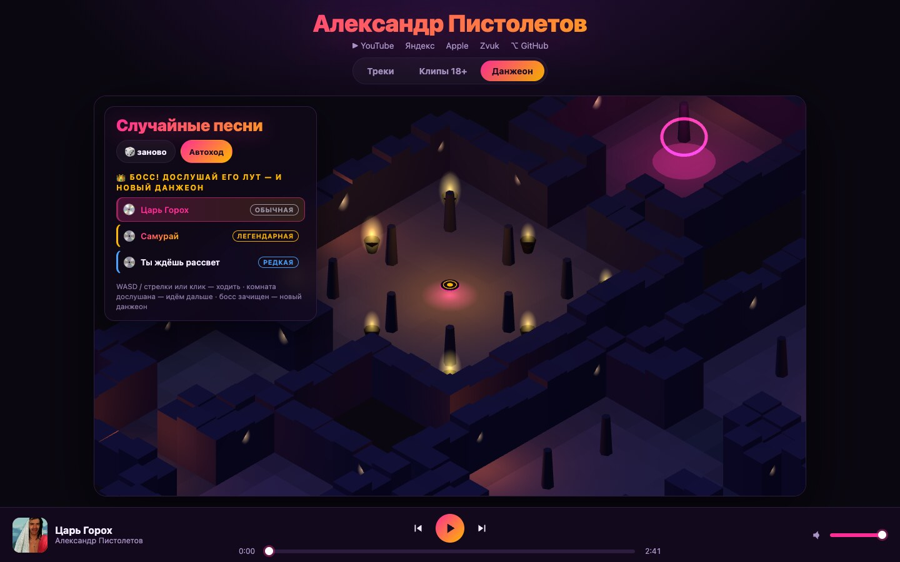</td>
<td width="50%">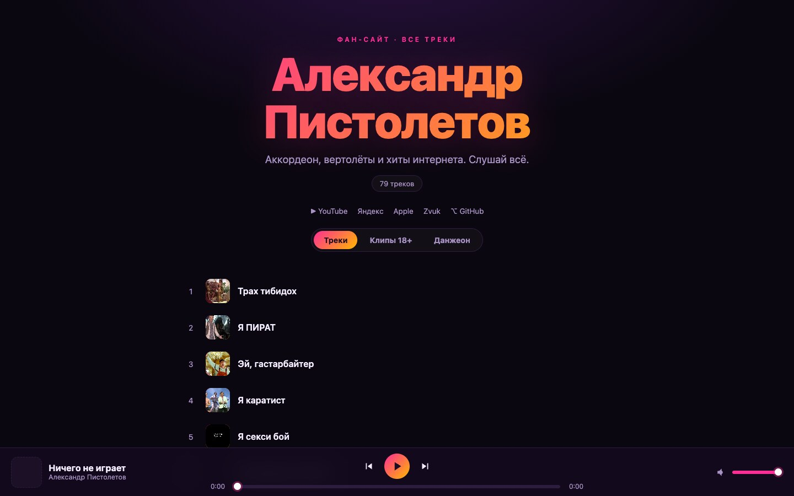</td>
</tr>
</table>

A fan site for Alexander Pistoletov with a custom player, a clips section and a procedural isometric 3D dungeon where the songs are loot. Each room drops tracks by rarity, the boss always has a legendary one, and once you clear the boss a new dungeon is generated and can be shared by seed. It's vanilla TypeScript, works offline as a PWA, has a single runtime dependency (three.js) and 78 tests. → [**repo**](https://github.com/Hilsdalle/pistoletov-fan)

`Vite` · `TypeScript` · `three.js` · `Vitest` · `PWA`

---

### 👾 PixelAvia: pixel-art flight search

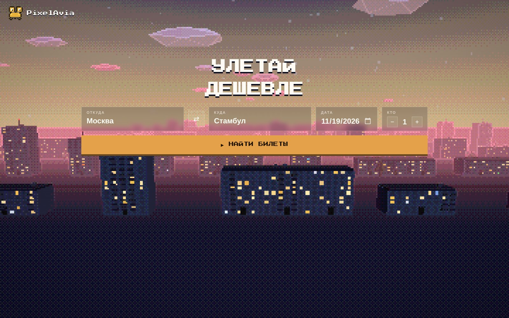

A cheap-flights search set in a living pixel-art city: clouds drift, windows light up, planes fly over. Under it is a WebAudio soundscape that follows the passing airliner. Airport autocomplete and flight search run on the PassTiket API.

`React 19` · `three.js` · `troika-three-text` · `WebAudio`

---

### ⭐ Fragment API and StarSailor: Telegram Stars and Premium reseller

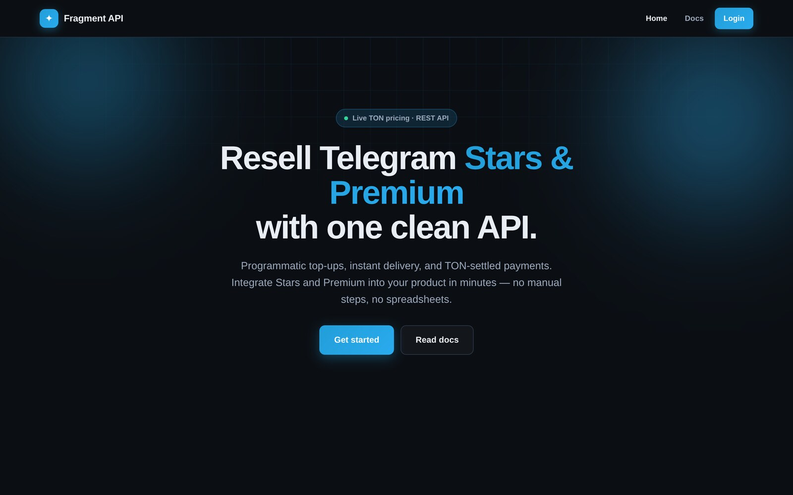

A back-end and API that resell **Telegram Stars and Premium**, settled in **TON**. It quotes the exact Fragment price before paying, then reserves and checks the balance against that quote. It also keeps an internal TON ledger, sweeps deposit addresses on-chain, screens senders with a free AML check and rate-limits globally. StarSailor, an earlier storefront for card payments (YooKassa), ships as a one-command `docker-compose` deploy behind Nginx with HTTPS.

`FastAPI` · `Python` · `TON / Fragment` · `Docker` · `Nginx`

---

### 🛫 Flight-price scrapers

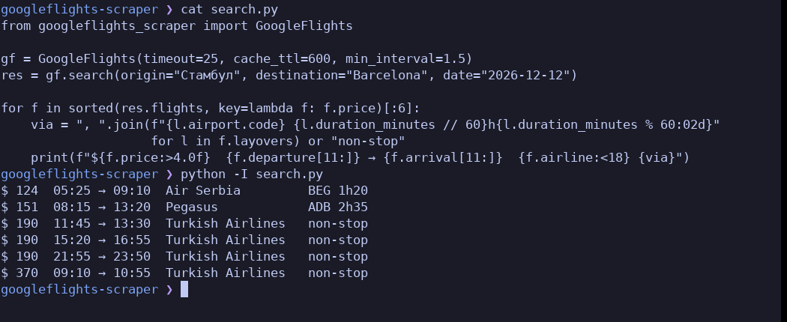

Typed Python libraries for real flight prices: [**googleflights-scraper**](https://github.com/Hilsdalle/googleflights-scraper), [**aviasales-scraper**](https://github.com/Hilsdalle/aviasales-scraper), and [**flight-queue**](https://github.com/Hilsdalle/flight-queue) as the async layer in front of them. City names work in Russian or English, layovers are resolved, responses are cached and rate-limited with a token bucket, duplicate in-flight requests are merged and a proxy pool rotates. The screenshot is a live search.

`Python` · `asyncio` · `arq` · `curl_cffi`

---

### 🛠 Claude Code tooling

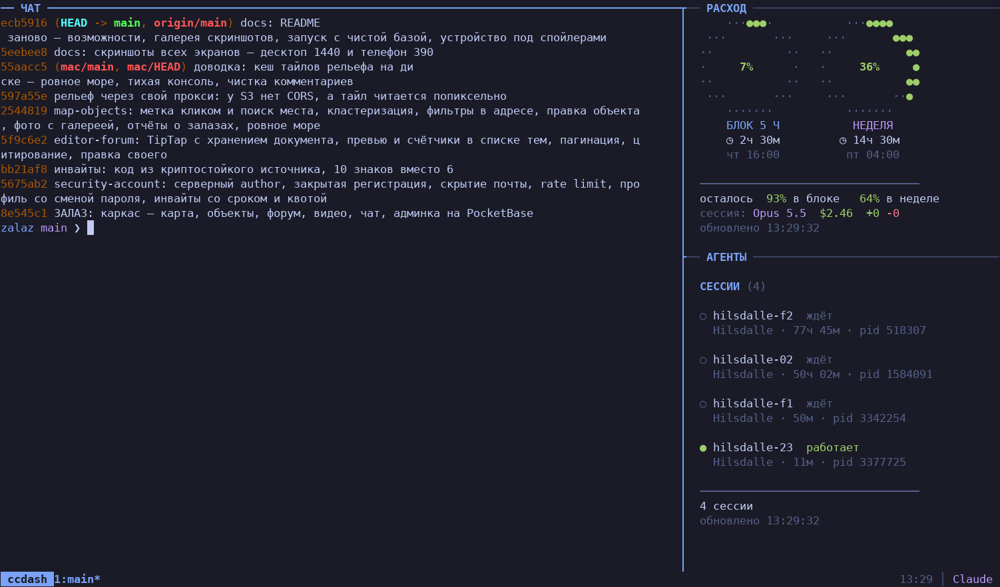

- [**ccdash**](https://github.com/Hilsdalle/ccdash): a terminal and dashboard for Claude Code. The real Anthropic rate limits show as ring gauges, next to the sessions and agents that are running. Python, no dependencies.
- **claude-hub**: one command turns a clean Ubuntu 26.04 into a remote dev hub with a desktop, Tailscale to the Mac and Windows boxes, two GitHub identities and two Claude profiles. Ansible + Terraform.
- **claude-fanout**: parallel delivery with Claude Code. A coordinator fans features and bugs out to agents, each in its own git worktree, squash-merges what comes back and ships it in waves. Starter kit: [**claude-uchebka**](https://github.com/Hilsdalle/claude-uchebka).

---

Most project repositories are private. I'm happy to walk through the code or give access on request.

📩 <b><a href="https://t.me/hillsdale">@hillsdale</a></b> on Telegram

