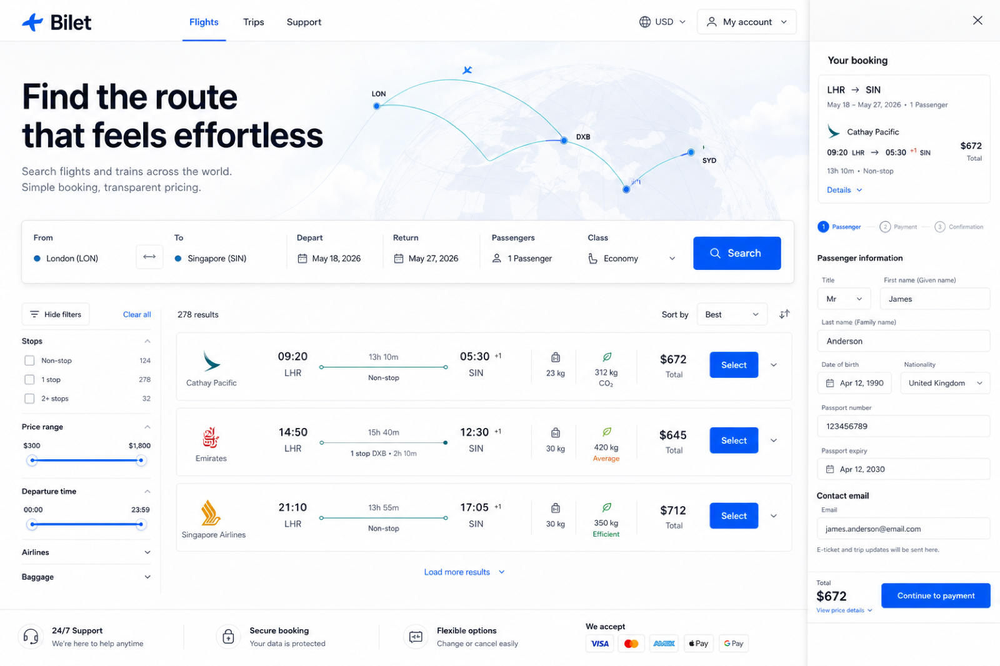
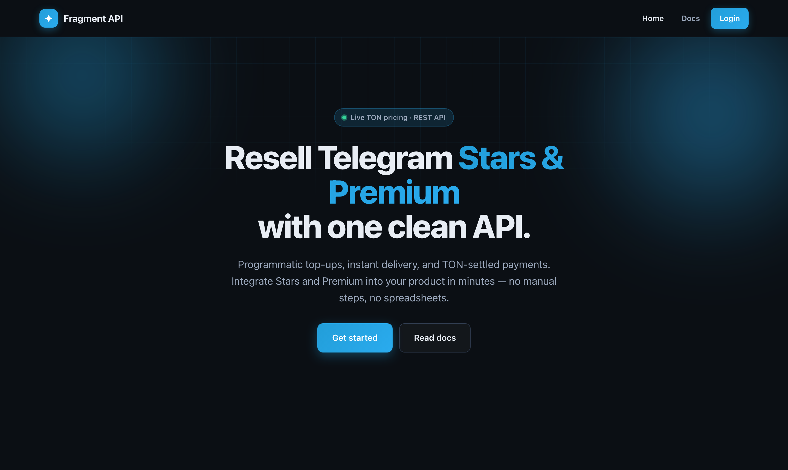
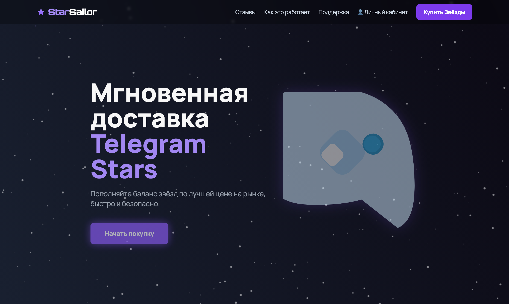
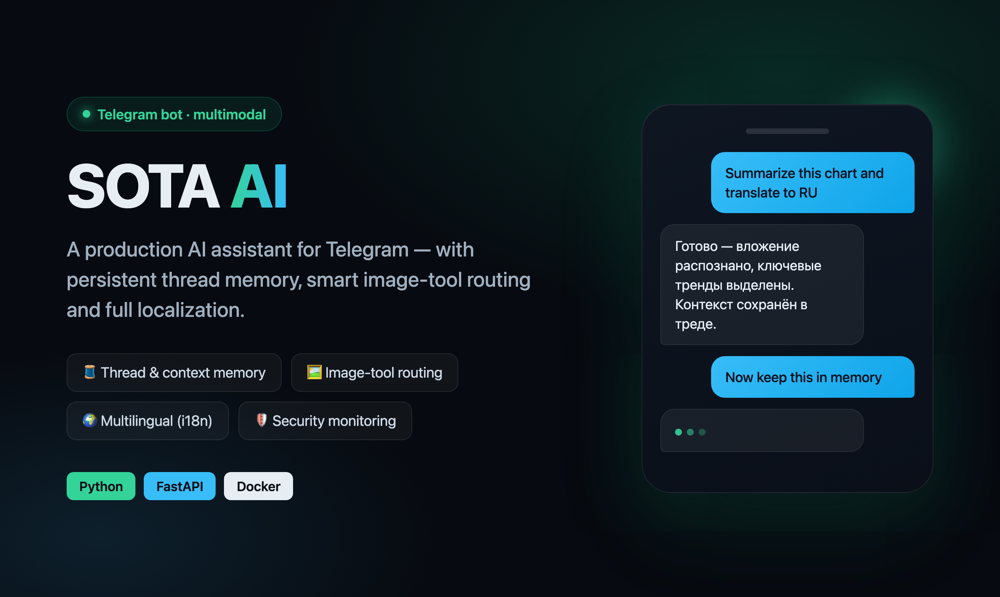

<h1 align="center">Hi, I'm zhmyh 👋</h1>

  <b>Full-stack Developer</b> · React + TypeScript / Python + FastAPI · Telegram &amp; TON ecosystem

  
  

---

### About

I build complete products end-to-end — from animated React interfaces to FastAPI back-ends, payment/crypto integrations, and Dockerized deployments behind Nginx. Most of my recent work lives in the **Telegram & TON** ecosystem: reselling Stars/Premium, on-chain settlement, AML screening, and AI assistants. I care about clean APIs, real error states, and shipping things that actually run in production.

### Tech Stack

---

## Featured Projects

### ✈️ Bilet — flight search &amp; booking UI

A modern single-page flight search & booking experience: search → filters & sorting → booking drawer → passenger details & payment → confirmation. Full internationalization with browser-language auto-detection and ISO-currency formatting via the native `Intl` API.

`React` · `Vite` · `Tailwind CSS` · `Motion` · `i18next`

---

### ⭐ Fragment API — Telegram Stars &amp; Premium reseller

A back-end + dashboard to resell **Telegram Stars and Premium**, settled in **TON**. Quotes the exact Fragment price before paying, reserves and checks balance against it, runs **free AML screening** of deposit senders, enforces global rate-limiting, and scrubs secrets from audit logs.

`FastAPI` · `Python` · `JavaScript` · `TON / Fragment`

---

### 🚀 StarSailor — Dockerized Stars delivery service

A self-hostable service for instant Telegram Stars & Premium delivery via the Fragment API. FastAPI back-end + Nginx-served front-end, packaged for **one-command `docker-compose` deployment** with HTTPS and auto-start.

`FastAPI` · `Docker` · `Nginx` · `Python`

---

### 🤖 SOTA AI — multimodal Telegram assistant

A production AI assistant for Telegram with persistent **thread & context memory**, smart **image-tool routing**, full **localization (i18n)**, and security monitoring — containerized with Docker.

`Python` · `FastAPI` · `Docker`

---

Project repositories are private — happy to walk through the code or give access on request.

📩 <b><a href="https://t.me/hillsdale">@hillsdale</a></b> on Telegram

